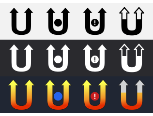

# Unison Cue

[](https://github.com/haavardj/unison-cue/actions/workflows/ci.yml)
[](https://github.com/haavardj/unison-cue/releases/latest)

[](https://github.com/haavardj/unison-cue/releases/latest/download/UnisonCue-macOS.zip)
[](https://github.com/haavardj/unison-cue/releases/latest/download/UnisonCue-windows-x64.zip)
[](https://github.com/haavardj/unison-cue/releases/latest/download/UnisonCue-windows-arm64.zip)
[](https://github.com/haavardj/unison-cue/releases/latest/download/unison-cue_amd64.deb)

macOS 13 or later (Apple silicon and Intel) · Windows 10/11 ·
Ubuntu and other Linux desktops (also
[arm64 .deb](https://github.com/haavardj/unison-cue/releases/latest/download/unison-cue_arm64.deb),
[tarball](https://github.com/haavardj/unison-cue/releases/latest/download/UnisonCue-linux-amd64.tar.gz),
[arm64 tarball](https://github.com/haavardj/unison-cue/releases/latest/download/UnisonCue-linux-arm64.tar.gz)) ·
[all releases](https://github.com/haavardj/unison-cue/releases) ·
[install notes](#install)

A small menu bar (macOS) and system tray (Windows, Linux) app for the
[Unison](https://github.com/bcpierce00/unison) file synchronizer.

Syncing is always started by the user. The app keeps track of when each
profile was last synced. When a profile has gone unsynced for too long, the
icon gets a badge and a notification suggests a sync.

## Install

1. Install [Unison](https://github.com/bcpierce00/unison) itself, for
   example with `brew install unison` (macOS) or the Windows zip from the
   [Unison releases](https://github.com/bcpierce00/unison/releases).
2. Download Unison Cue with the buttons above, or from the
   [Releases page](https://github.com/haavardj/unison-cue/releases).
   - **macOS:** unzip and move **Unison Cue.app** to `/Applications`. The
     app is not notarized by Apple, so on first launch right-click it and
     choose **Open**, or run
     `xattr -dr com.apple.quarantine "/Applications/Unison Cue.app"`.
   - **Windows:** unzip and run `UnisonCue.exe`. The exe is not code
     signed, so SmartScreen may ask you to confirm (**More info → Run
     anyway**).
   - **Ubuntu / Debian:** `sudo apt install ./unison-cue_amd64.deb` (or
     `_arm64.deb`), then start **Unison Cue** from the applications menu.
     This also installs `unison` and `zenity` if they are missing.
   - **Other Linux:** unpack the tarball and run `./install.sh`. It
     installs into `~/.local` for your user only; `./install.sh --uninstall`
     removes it.
3. Turn on **Start at Login** in the menu. Do this after moving the app to
   its final location, because the login item records the app's path.

Each release has a `SHA256SUMS.txt` for checking downloads.

## What it does

- Lists the profiles (`*.prf`) in your Unison directory (`$UNISON`,
  `~/.unison`, or on macOS `~/Library/Application Support/Unison`). New or
  removed profiles are picked up within a minute. A `label = ...` line in a
  profile is used as its display name.
- **Sync Now** (per profile) and **Sync All Now** run
  `unison <profile> -batch -ui text` in the background, one profile at a
  time. A notification reports the result.
- Conflicts and other items that batch mode cannot decide are skipped and
  shown as ⚠ in the menu. **Resolve Conflicts in Terminal…** opens Terminal
  (macOS) or a console window (Windows) running unison interactively.
- **Stop Syncing** cancels the running sync, including its ssh process.
- Reminders: a profile is *due* when its last completed sync is older than
  the reminder interval (default 1 day, set under **Remind Me After**).
  - Due profiles show ● in the menu, and the icon gets a badge.
  - A notification is shown at most every 4 hours while something is due.
    **Snooze Reminders** pauses notifications for 1 hour, 4 hours, or until
    9:00 the next morning.
  - Per profile, you can turn reminders off or leave a profile out of
    **Sync All**.
- **Start at Login** adds a LaunchAgent (macOS) or an `HKCU\…\Run` entry
  (Windows).
- **View Last Log** shows unison's full output for the last run. The run
  before that is kept as `<profile>.log.1`.

### Tray icon

The icon is the Unison logo, a "U" made of two upward arrows. On macOS it
is a monochrome template image that follows the menu bar's colour. On
Windows it uses the logo's colours.



From left to right: up to date; a sync is due (dot in the U); the last sync
failed or left conflicts ("!"); syncing (the U fills up from the bottom,
animated).

## Settings

**Settings…** in the menu opens the settings window, with four tabs:

- **General:** the unison program and profile folder, extra arguments,
  reminder intervals, the sync time limit, notifications, ssh dialogs and
  Start at Login.
- **Profiles:** for each profile, whether it appears in the menu, is part
  of **Sync All**, and gets reminders, plus its own reminder interval.
- **Environment:** variables passed to unison (such as
  `UNISONLOCALHOSTNAME`), and a list of every `UNISON*` variable in effect
  and where its value comes from.
- **About:** versions, and where the settings, logs and profiles are.

The window shows a page served by the app on `127.0.0.1`. It accepts only
requests that carry a random token created for that window, so other
programs and web pages cannot read or change the settings. On Windows the
window needs Microsoft's WebView2 runtime, which comes with Windows 10 and
11; without it, the settings open in your browser instead.

The same settings live in `config.json`, which you can also edit by hand
(**More ▸ Edit Settings File…**). It lives in
`~/Library/Application Support/Unison Cue/` on macOS and
`%AppData%\Unison Cue\` on Windows, and `~/.config/unison-cue/` on Linux. Changes are applied within a minute.

```json
{
  "unisonPath": "/opt/homebrew/bin/unison",
  "unisonDir": "",
  "extraArgs": ["-fastcheck", "true"],
  "reminderHours": 24,
  "renotifyHours": 4,
  "timeoutMinutes": 120,
  "quietSuccess": false,
  "environment": { "UNISONLOCALHOSTNAME": "my-laptop" },
  "profiles": {
    "photos": { "reminderHours": 168, "excludeFromSyncAll": true },
    "old-laptop": { "hidden": true }
  }
}
```

| Key | Meaning |
|---|---|
| `unisonPath` | unison executable. If empty, the app searches PATH, Homebrew/MacPorts, `C:\Program Files\Unison`, Scoop and WinGet. |
| `unisonDir` | Profile directory, if it differs from unison's own default. |
| `extraArgs` | Extra arguments added to every background run. |
| `reminderHours` | How long a profile can go unsynced before it is due. |
| `renotifyHours` | Minimum time between two reminder notifications. |
| `timeoutMinutes` | Stops a background run that takes longer than this. 0 means no limit. |
| `quietSuccess` | Skip the notification when a sync finishes without problems. |
| `noSshAskpass` | Never show ssh passphrase/password dialogs. |
| `environment` | Extra environment variables for unison, such as `UNISONLOCALHOSTNAME`. These take precedence over all others. `UNISON` here also sets the profile folder. |
| `noShellEnvironment` | macOS: do not read `UNISON*` variables from your login shell (see below). |
| `profiles.<name>` | `hidden`, `excludeFromSyncAll`, `noReminder`, `reminderHours` |

`state.json` in the same folder records the last sync times. The app's own
log is `unison-cue.log`, and unison's output is in `logs/`.

## Environment variables

Unison reads several environment variables, such as `UNISON` (the profile
folder) and `UNISONLOCALHOSTNAME` (the host name used to find its
archives). If unison sees a different host name, it does not find its
archives and treats the next sync as a first sync.

On macOS, apps started from the Finder or at login do not see variables
exported in `~/.zshrc` or `~/.bash_profile`. At start-up, Unison Cue
therefore runs your login shell once and copies every `UNISON*` variable it
finds that is not already set. The app's log
(`unison-cue.log`) lists the names it imported, without their values. For a
fixed value, or on Windows, use `environment` in the settings file. On
Windows, variables set under *System → Environment Variables* are inherited
anyway.

## Linux notes

- The tray icon needs a panel that supports AppIndicator / StatusNotifierItem
  icons. Ubuntu has this by default. On plain GNOME (Fedora, Debian),
  install the *AppIndicator and KStatusNotifierItem Support* extension
  (`gnome-shell-extension-appindicator`). KDE Plasma, Xfce, Cinnamon and
  MATE support it out of the box.
- The settings open in your web browser instead of a separate window.
- ssh passphrase dialogs use `zenity` (GNOME) or `kdialog` (KDE).
- Interactive syncs open in your default terminal (`x-terminal-emulator`,
  GNOME Terminal, Ptyxis, Console, Konsole, Xfce Terminal or xterm).
- Settings and logs are kept in `~/.config/unison-cue`. **Start at Login**
  adds `~/.config/autostart/unison-cue.desktop`.
- The login-shell import reads `UNISON*` variables from `~/.profile` and
  `~/.bashrc` (or your shell's equivalents).

## Remote roots and passwords

Background runs have no terminal. When ssh needs a key passphrase, a
password, or confirmation of an unknown host key, Unison Cue shows a dialog
(ssh's `SSH_ASKPASS` mechanism, OpenSSH 8.4 or newer). If you cancel the
dialog or leave it unanswered for 3 minutes, the run fails.

Without extra setup, the dialog appears on every sync. To enter a
passphrase only once, have ssh keep the key in the agent (and, on macOS, in
the Keychain) by adding this to the host's entry in `~/.ssh/config`:

```
AddKeysToAgent yes
UseKeychain yes      # macOS only
```

Set `"noSshAskpass": true` to turn the dialogs off.

## Building

Requires Go 1.27.4 or newer (older 1.27 releases have known `net/http` vulnerabilities). All code is in this repository. The only
third-party dependencies are `fyne.io/systray` and `golang.org/x/sys`.

```sh
go test ./...                    # unit and integration tests (fake unison)
./scripts/build-macos.sh         # build/Unison Cue.app (universal) + zip
./scripts/build-windows.sh       # build/UnisonCue.exe (x64) + -arm64.exe, cross-compiled
./scripts/build-linux.sh         # build/UnisonCue-linux-*.tar.gz, and .deb packages if dpkg-deb is installed
```

On Windows, the native build is
`powershell -ExecutionPolicy Bypass -File scripts\build-windows.ps1`.

The macOS build needs the Xcode command-line tools (cgo). The app is
ad-hoc signed, which is enough on the Mac that built it. To distribute it,
sign it with a Developer ID and notarize it. The Windows build needs no C
toolchain. Set `EMBED_ICON=1` to give the `.exe` an Explorer icon through
the third-party `go-winres` tool. The tray icon works without it.

## License

Copyright (C) 2026 Håvard Dagenborg

Unison Cue is free software: you can redistribute it and/or modify it
under the terms of the GNU General Public License as published by the Free
Software Foundation, either version 3 of the License, or (at your option)
any later version. See [LICENSE](LICENSE).

This program is distributed in the hope that it will be useful, but
WITHOUT ANY WARRANTY; without even the implied warranty of MERCHANTABILITY
or FITNESS FOR A PARTICULAR PURPOSE.

### Logo and attribution

The "U" in the tray icon and app icon is the Unison logo. Its outline and
colours come from `icons/U.svg` in the
[Unison repository](https://github.com/bcpierce00/unison), which is also
licensed under GPL-3.0-or-later. Unison Cue is an independent front end,
not part of the Unison project.

The project logo adds a blue *cue light* in the U's hollow: the signal
that it is time to sync, and the same dot the tray icon shows when a
profile is due.

`assets/` holds the logo (`logo.svg`, `logo-wordmark.svg`) and PNG
renderings. All icons and both SVGs are generated from one description in
`internal/icon`. Regenerate them with `go run ./cmd/mkicons -assets assets`.

## Layout

```
main.go, app.go, menu.go     tray app: sync queue, reminders, menu
internal/core                config/state files, profile discovery, runner, reminder rules
internal/icon                tray/app icons drawn in code from the Unison logo outline
internal/platform            notifications, autostart, terminal, single instance (per OS)
cmd/mkicons                  writes .icns/.ico for packaging and the PNGs in assets/
assets/                      project logo (SVG, PNG) and tray icon preview
scripts/                     build scripts
```

## Security

See [SECURITY.md](SECURITY.md) for how to report a vulnerability and how
the app handles passwords, files and external programs.

## Related projects

- [jone/unison-tray](https://github.com/jone/unison-tray) (2015, archived)
  was an earlier tray icon for unison. It synced automatically on file
  changes.
- [Gunison](https://github.com/vfaronov/gunison) (archived) and Unison's
  own GTK interface are full windows for reviewing a sync.

## Known limitations

- Notifications on macOS go through `osascript` and appear under "Script
  Editor". On Windows they are PowerShell toasts. Clicking a notification
  does nothing. Use the tray menu.
- Only syncs started from Unison Cue count as "last synced". Syncs run
  from the command line are not detected.
- The Windows variant compiles and its logic is tested here on macOS, but
  it has not yet been run on a Windows machine.
